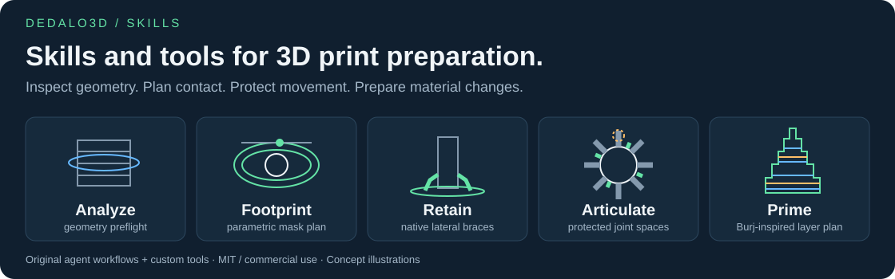
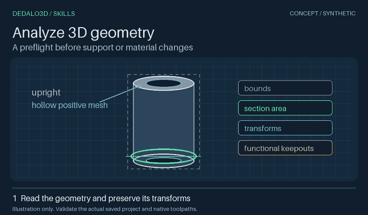
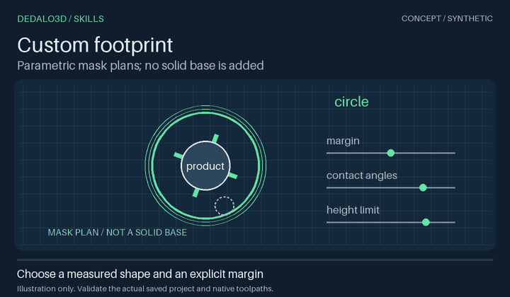
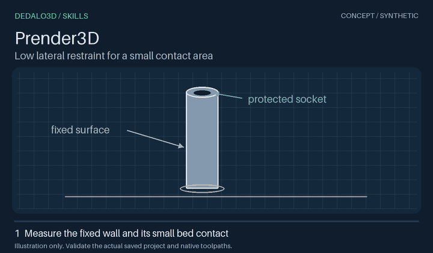
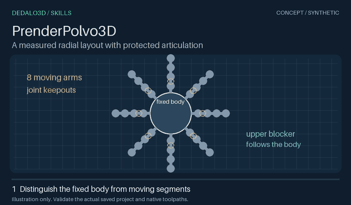
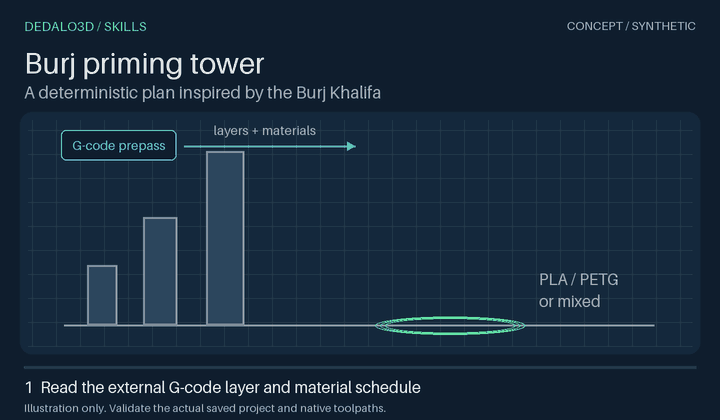
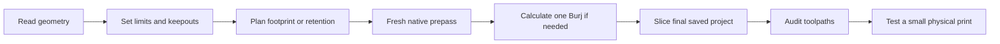

# Dedalo3Dskills

[](LICENSE)

**Measure the part. Prepare the print. Check the toolpaths.**

Agent skills and deterministic tools for practical 3D printing: geometry analysis, parameterized contact footprints, localized retention and a custom Burj purge/priming tower.

[Português brasileiro](README.pt-BR.md) · [Catalog](#skill-catalog) · [Tools](tools/README.md) · [MIT — commercial use permitted](LICENSE)



## Install

Use the [skills CLI](https://github.com/vercel-labs/skills):

```bash
npx skills@latest add MoraesGil/Dedalo3Dskills --skill analyze-3d-geometry custom-footprint prender-3d prender-polvo-3d torre-burj
```

Choose your agent when prompted. Installation is project-local by default. Analysis, footprint and octopus skills reuse `prender-3d`; install it alongside them. Burj is self-contained. Dependencies are declared in the instructions; do not assume the installer resolves them automatically.

For a checkout, create a Python virtual environment and install the geometry dependencies:

```bash
git clone https://github.com/MoraesGil/Dedalo3Dskills.git
cd Dedalo3Dskills
python -m pip install -r skills/printing/prender-3d/requirements.txt
```

Python 3.12 is tested. Read the relevant `SKILL.md` before running helpers. No slicer, printer preset or printer connection is bundled.

## Skill catalog

| Skill | Use case | Output and limit |
| --- | --- | --- |
| [Analyze 3D geometry](skills/analysis/analyze-3d-geometry/SKILL.md) | Inspect a multipart project before editing. | Read-only sections, transforms and functional constraints that need review. |
| [Custom footprint](skills/printing/custom-footprint/SKILL.md) | Choose contour, contacts, margin, height and keepouts. | Native retention-mask plan; no modeled solid base. |
| [Prender3D](skills/printing/prender-3d/SKILL.md) | Restrain tall grips and parts with small bed contact. | Local native support/brim touching approved fixed surfaces. |
| [PrenderPolvo3D](skills/printing/prender-polvo-3d/SKILL.md) | Restrain the supported eight-arm octopus family. | Low common-base contacts with moving joints protected. |
| [Burj tower](skills/printing/torre-burj/SKILL.md) | Calculate one tower from fresh prepass G-code. | Prepared 3MF, layer/material plan and fresh-G-code audit. |

### Analyze before editing

> Analyze this 3MF without changing it. Measure its first-layer section, identify roots and modifiers, and show fixed surfaces and keepouts that need review.



### Parameterize the footprint

> Plan an elliptical retention footprint with eight contact angles, a 3 mm height ceiling and explicit joint keepouts. Preserve the socket. Generate native modifier descriptors for review.



The planner produces JSON. Applying it and slicing are separate steps. “Custom footprint” describes the support/brim contact plan; it adds no printable collar, foot or base.

### Keep a tall handle steady

> Use Prender3D on this handle. Measure fixed walls and bed contact. Add low native lateral support within my height limit. Protect the socket, preserve geometry and settings, and check a fresh slice.



Support must touch the intended fixed surface above the first layer and remain connected to the bed. Detached islands provide no lateral restraint. Our grip-print experience motivates this workflow; it does not guarantee adhesion for every machine and material.

### Protect articulated joints

> Use PrenderPolvo3D if the geometry matches its template. Keep support in the approved 0–3 mm band of the fixed common base. Use shape-following blockers and protect every moving joint. Keep brim off the octopus and support tree.



This 3 mm profile belongs to the common base, not half the themed head. Support height, enforcer thickness and branch diameter are separate parameters.

### Build one Burj purge/priming tower

> Calculate a Burj from the saved project and fresh tower-free G-code. Preserve printer, materials and temperatures. Complete a tower passage after each real tool change, before product or interface deposition. Stop at the last real change. Validate the final native G-code.



Inspired by the **Burj Khalifa**, the stepped profile combines a broad adhesion footprint with a narrowing upper section. The calculator accounts for different object heights/sizes, per-layer materials, minimal structural growth and configurable brim. PETG, PLA and mixed-material projects use their existing calibrated physical slots; no universal temperature or adhesion guarantee is supplied.

The contract is **one physical custom tower**. On the tested Snapmaker U1, enabling the native prime tower creates an additional tower. This workflow keeps it disabled and verifies actual extrusion in the Burj after each tool change. A persisted “Flush into this object” checkbox alone does not prove that the engine routed purge there. See the [Burj skill](skills/printing/torre-burj/SKILL.md) for supported settings and limits.

All five animations are original **synthetic concept diagrams**, not slicer recordings or physical print evidence. [Static posters and the reproducible renderer](assets/previews/README.md) are included.

## How the skills fit together



Use only the skills needed. Analysis can stop at a report. A monochrome part may need retention without a tower. Geometry, paint, orientation, support, scale or settings changes invalidate the previous tower calculation.

## Repository layout

```text
skills/analysis/<name>/       Read-only inspection skills
skills/printing/<name>/       Print-preparation skills
  SKILL.md                   Trigger, scope and workflow
  scripts/                   Owning implementation, included in skill installation
  references/ or examples/   Detailed contracts and inputs where needed
tools/dedalo3d/               Thin checkout-only command wrappers
assets/previews/             Concept GIFs, static posters and catalog
tests/                       Synthetic fixtures and checks
```

Algorithms stay with their owning skill; wrappers do not duplicate them. [Tools and commands](tools/README.md) explain checkout and installed-skill layouts.

## Compatibility and checks

Project helpers target **complete Orca/Bambu-family 3MF projects with metadata**, not bare STL or mesh-only 3MF. The reference native engine is **Snapmaker Orca**. Other engines need their own compatibility check.

Tests cover synthetic geometry, metadata preservation and planning/audit invariants. Burj also has a small native U1 pilot: explicit-command checks passed, while opaque firmware macros leave the strict overall audit incomplete. These checks do not prove physical adhesion, joint freedom or cleaning on every material. Inspect final toolpaths and test a small physical print.

Read [compatibility](docs/compatibility.md), the [retention workflow](docs/retention-workflow.md) and [native slicing](docs/slicing.md). No tool starts or controls a printer.

```bash
python scripts/validate_repository.py
python -m unittest discover -s tests -v
```

Tests create projects in temporary folders. The optional [GitHub Actions recipe](docs/ci/README.md) is under `docs/ci`; it is not active CI. Preview rendering has a separate optional Pillow dependency.

## More skills to curate

Our local 3D garden also has candidates for PETG interface bridges, added weight, fragility review, multiview paint auditing and general print preparation. Each needs a focused public export and license review before joining the catalog. No placeholder skill or private customer model is included.

Contribute a concrete printing problem, bounded skill and reproducible check. See [CONTRIBUTING.md](CONTRIBUTING.md).

## License and inspiration

Original skills, code, illustrations and documentation use **[MIT](LICENSE)**, permitting commercial use, modification and redistribution under its terms. Models, dependencies and printer software keep their licenses. [Burj NOTICE](skills/printing/torre-burj/NOTICE.md) records the limited provenance of the exported Burj modules.

The organization is inspired by [Matt Pocock's skills repository](https://github.com/mattpocock/skills): focused skills, a clear catalog and a short path to use. The Burj shape takes inspiration from the Burj Khalifa. Our print-preparation tools and synthetic illustrations are original work.
