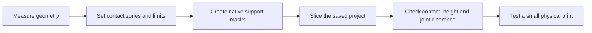

# Dedalo3Dskills

[](LICENSE)

**Keep the part steady. Keep the joints moving.**

Practical agent skills for 3D printing. The first family, **Prender3D**, helps an AI agent measure a part, choose useful contact surfaces, and add limited native brim and lateral support to keep the part steady on the bed.

[Português brasileiro](README.pt-BR.md) · [Skill catalog](#skill-catalog) · [MIT license — commercial use permitted](LICENSE)


## Why this exists

A tall handle can have very little bed contact. An articulated figure can need extra restraint at its fixed body while its joints must remain free. Blanket support can make removal difficult or interfere with those moving parts.

Prender3D starts with the geometry and the limits you set. It helps select fixed surfaces for low lateral contact, protect joints and fittings, and shape support masks around the actual object. The slicer then generates the native support and brim allowed by that plan. Retention uses those removable slicer features; the product does not gain a modeled collar or base.

This workflow grew from real print preparation. Our own grip prints have worked well with this approach. That experience is useful feedback, not a guarantee for every printer, material or shape.

## Get the skills

Install the family with the [skills CLI](https://github.com/vercel-labs/skills), which requires Node.js 22.20 or later:

```bash
npx skills@latest add MoraesGil/Dedalo3Dskills --skill prender-3d prender-polvo-3d
```

Choose your agent when prompted. The CLI installs into the current project by default; a global installation is optional. Keep both skills when using the octopus specialization: it uses Prender3D's shared helpers and rules.

### Review the source or work from a checkout

```bash
git clone https://github.com/MoraesGil/Dedalo3Dskills.git
cd Dedalo3Dskills
```

Create and activate a Python virtual environment for your platform, then install the geometry dependencies:

```bash
python -m pip install -r skills/printing/prender-3d/requirements.txt
```

Ask your agent to read the relevant `SKILL.md` from the checkout. Read it yourself before running the helpers. The skill files and Python helpers do not install a slicer or provide printer presets.

## Skill catalog

| Skill | Use it for | Main constraint |
| --- | --- | --- |
| [Prender3D](skills/printing/prender-3d/SKILL.md) | Tall grips, small contact areas and other parts that need limited lateral restraint. | Measure the geometry and use the contact zones, height and keepouts requested for that part. |
| [PrenderPolvo3D](skills/printing/prender-polvo-3d/SKILL.md) | Articulated octopi that match the supported eight-arm geometry. | Protect the joints and keep the approved low support profile on the fixed common base. |
| [Destacar relevo 3D](skills/printing/destacar-relevo-3d/SKILL.md) | Raised outlines, emblems and selected accents from a reference image. | Register the image to the surface and verify the colored root in fresh G-code. |

Prender3D is the reusable core. PrenderPolvo3D adds a measured radial layout and a specific octopus profile. New skills will join this catalog as they become useful and ready to share.

## Try it

### A tall handle

> Use Prender3D on this handle. Measure the fixed surfaces and its bed contact. Add native brim and lateral support with a maximum height of 5 mm. Protect the socket and all fitting surfaces. Keep each copy as a separate assembly. Measure the spacing before arranging the copies. Preserve the product geometry, paint and print settings. Show the saved result and validate a fresh slice.

The height in this prompt is a user constraint, not a universal recommendation. Support height, the enforcer's Z thickness and branch diameter are separate measurements.

### An articulated octopus

> Use PrenderPolvo3D on this octopus. First confirm that its geometry matches the eight-arm template. Use the approved 0–3 mm support profile on the common base, with contact to the fixed body and protection around the moving joints. Use compact blockers that follow the measured shape. Keep brim off the body, tentacles and support tree. Preserve the assembly and validate the fresh G-code.

The 3 mm profile belongs to this template's common base. It does not mean half the height of any themed head, and it is not a default for unrelated parts.

## Create a raised highlight

```bash
npx skills@latest add MoraesGil/Dedalo3Dskills --skill destacar-relevo-3d
```

> Use destacar-relevo-3d with this image and part. Identify the motif, verify scale and surface registration, and create a raised white outline. Preserve the opening and project data. Confirm the white root in fresh G-code.

The optional helper generates a planar relief mesh only. It does not read images, edit a 3MF or slice. [Read the contract and synthetic example](skills/printing/destacar-relevo-3d/SKILL.md).

## How the workflow works



The agent makes the geometric decisions and adapts the plan. Local helpers support measurement, native modifier creation and focused checks. A compatible slicer produces the actual toolpaths.

Useful restraints must touch the intended fixed surfaces and remain continuous from the bed. Validation must also check protected regions, mask clearance from nearby parts or towers, and the support height in the final G-code. A modifier in a 3MF, or a successful slicer exit code, is not enough by itself.

See the [retention workflow](docs/retention-workflow.md) for the detailed contract and [compatibility](docs/compatibility.md) for supported inputs, dependencies and current limits.

## Compatibility and validation

The helpers target **complete Orca/Bambu-family 3MF projects with their project metadata**. A mesh-only 3MF does not carry the same information. The reference slicing workflow uses **Snapmaker Orca**; other slicers and engines need their own validation.

There is no universal support plan or automatic certification of every G-code. Joint clearance, removal, surface marks, adhesion and vibration depend on the actual print. Start with a small test before committing to a production batch.

## Development checks

    python scripts/validate_repository.py
    python -m unittest discover -s tests -v

The tests generate their own synthetic geometry. An optional [GitHub Actions workflow](docs/ci/README.md) is supplied as a recipe; it is not active from the docs directory.

## Add a useful skill

Contributions should solve a concrete printing problem, declare their scope, and include a reproducible way to check the result. Use synthetic fixtures or files you have permission to redistribute. See [CONTRIBUTING.md](CONTRIBUTING.md).

## License and inspiration

The original skills, code and documentation in this repository use the **[MIT license](LICENSE)**. Commercial use, modification and redistribution are permitted under its terms. Input models, printer software and other third-party assets keep their own licenses; this repository does not grant rights to those assets.

The collection's organization is inspired by [Matt Pocock's skills repository](https://github.com/mattpocock/skills): focused skills, a clear catalog and a short path from installation to use. Prender3D's printing workflow and helpers are our own work.
