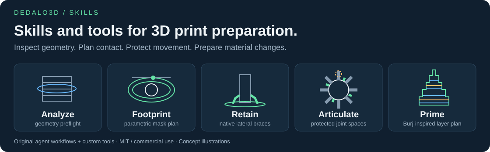
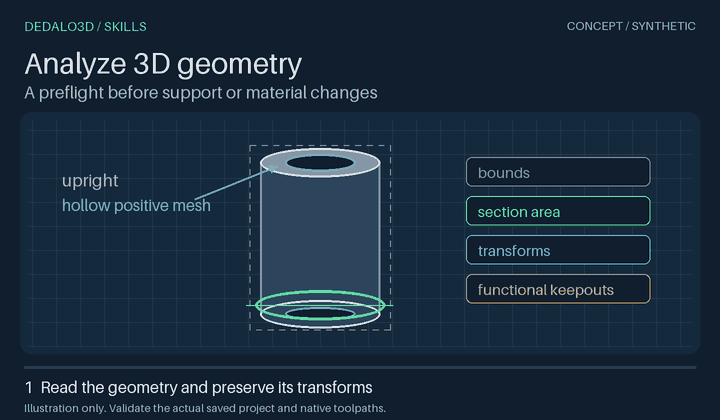
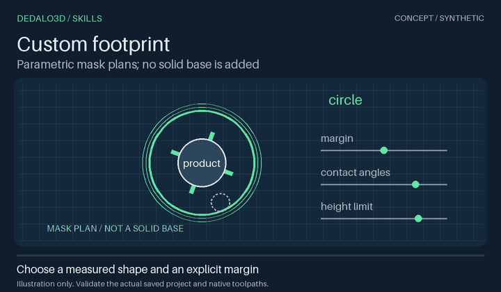
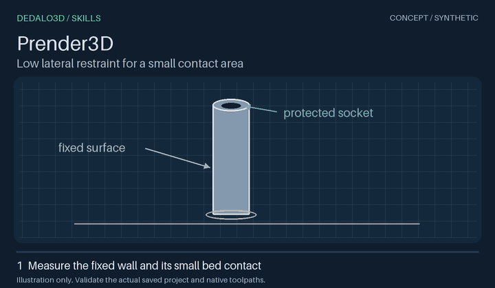
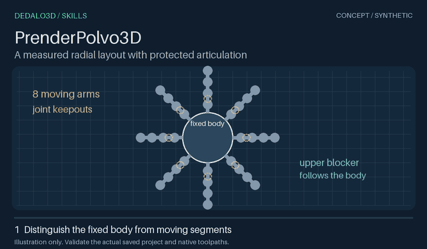
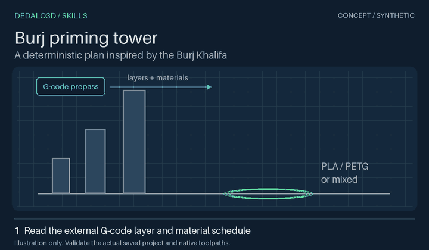
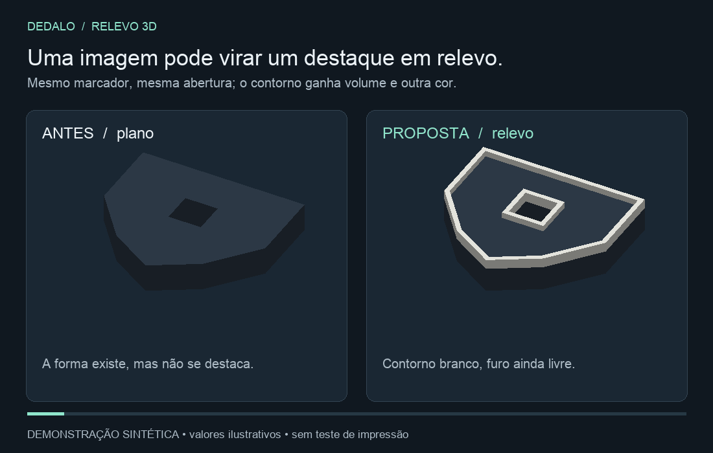
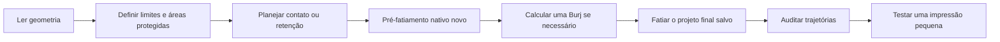

# Dedalo3Dskills

[](LICENSE)

**Meça a peça. Prepare a impressão. Confira as trajetórias.**

Skills e ferramentas determinísticas para impressão 3D: análise de geometria, área de contato parametrizável, retenção localizada, relevo guiado por imagem e torre Burj de purga e preparação do bico.

[English](README.md) · [Catálogo](#catálogo-de-skills) · [Ferramentas](tools/README.md) · [MIT — uso comercial permitido](LICENSE)



## Catálogo de skills

Clique na prévia para abrir o GIF em tamanho integral. As animações são conceitos sintéticos, sem teste de fatiamento ou impressão.

| Prévia | Skill | Quando usar |
| --- | --- | --- |
| [](assets/previews/analyze-3d-geometry.gif) | [Analyze 3D geometry](skills/analysis/analyze-3d-geometry/SKILL.md) | Inspecionar assemblies, transforms e seções da primeira camada. |
| [](assets/previews/custom-footprint.gif) | [Custom footprint](skills/printing/custom-footprint/SKILL.md) | Parametrizar máscaras de suporte, contatos e áreas protegidas. |
| [](assets/previews/prender-3d.gif) | [Prender3D](skills/printing/prender-3d/SKILL.md) | Firmar paredes fixas com suporte baixo e brim nativos. |
| [](assets/previews/prender-polvo-3d.gif) | [PrenderPolvo3D](skills/printing/prender-polvo-3d/SKILL.md) | Proteger as articulações da família de polvos compatível. |
| [](assets/previews/torre-burj.gif) | [Torre Burj](skills/printing/torre-burj/SKILL.md) | Calcular uma torre de purga a partir de G-code novo. |
| [](assets/previews/destacar-relevo-3d.gif) | [Destacar relevo 3D](skills/printing/destacar-relevo-3d/SKILL.md) | Planejar contornos e emblemas por imagem; helper STL plano. |

## Instalar

Use o [skills CLI](https://github.com/vercel-labs/skills):

```bash
npx skills@latest add MoraesGil/Dedalo3Dskills --skill analyze-3d-geometry custom-footprint prender-3d prender-polvo-3d torre-burj destacar-relevo-3d
```

Selecione seu agente. A instalação padrão fica no projeto atual. As skills de análise, footprint e polvo usam `prender-3d`; instale-as juntas. A Burj é independente. As instruções declaram as dependências; o instalador pode não resolvê-las automaticamente.

Para usar o código do repositório, crie um ambiente virtual Python e instale as dependências:

```bash
git clone https://github.com/MoraesGil/Dedalo3Dskills.git
cd Dedalo3Dskills
python -m pip install -r skills/printing/prender-3d/requirements.txt
```

Python 3.12 é a versão testada. Leia o `SKILL.md` antes de executar os scripts. O pacote não inclui fatiador, preset de impressora ou conexão com impressora.

## Exemplos de uso

### Analisar antes de editar

> Analise este 3MF sem alterá-lo. Meça a seção da primeira camada, identifique os assemblies e modificadores, e mostre as paredes fixas e regiões protegidas que precisam de revisão.

### Parametrizar a área de contato

> Planeje uma área de retenção elíptica com oito ângulos de contato, altura máxima de 3 mm e áreas protegidas nas articulações. Preserve o encaixe. Gere os descritores dos modificadores para revisão.

O planejador gera JSON. Aplicar o plano e fatiar são etapas separadas. Custom footprint define o contato de suporte e brim. Não cria colar, pé ou base sólida na peça.

### Firmar um cabo alto

> Use Prender3D neste cabo. Meça as paredes fixas e o contato com a mesa. Crie apoio lateral baixo dentro da altura que pedi. Proteja o encaixe, preserve geometria e ajustes, e confira um fatiamento novo.

O apoio precisa tocar a parede fixa acima da primeira camada e ter continuidade até a mesa. Uma ilha de suporte separada não segura a peça. Nossos testes com cabos motivaram este fluxo; eles não garantem adesão em qualquer impressora e material.

### Proteger as articulações

> Use PrenderPolvo3D se a geometria corresponder ao modelo da skill. Mantenha suporte na faixa aprovada de 0–3 mm da base fixa comum. Use blockers que sigam o formato e proteja todas as articulações. Não coloque brim no polvo nem na tree.

Os 3 mm são o perfil da base comum. Não representam metade da cabeça temática. Altura do suporte, espessura do enforcer e diâmetro do ramo são parâmetros distintos.

### Criar uma torre Burj de purga

> Calcule uma Burj com o projeto salvo e seu G-code novo sem torre. Preserve impressora, materiais e temperaturas. Faça uma passagem completa na Burj após cada troca real, antes de imprimir peça ou interface. Termine na última troca. Valide o G-code final.

A forma foi inspirada na **Burj Khalifa**. A base ampla favorece a adesão; o perfil reduz a largura na parte superior. O cálculo considera objetos de alturas e tamanhos diferentes, materiais por camada, crescimento estrutural mínimo e brim configurável. Projetos PETG, PLA e mistos usam os slots físicos já calibrados. A ferramenta não fornece temperatura universal nem garante adesão.

A regra é **uma única torre física custom**. Na Snapmaker U1 testada, habilitar a prime tower nativa cria outra torre. Este fluxo a mantém desligada e verifica a extrusão real na Burj após cada troca. O checkbox “Flush into this object” sozinho não comprova purga no objeto. A [skill Burj](skills/printing/torre-burj/SKILL.md) explica os ajustes e limites.

As seis animações são **diagramas conceituais sintéticos**. Não são gravações do fatiador nem prova de impressão física. Há [posters estáticos e renderer reproduzível](assets/previews/README.md).

### Criar um destaque em relevo

> Use destacar-relevo-3d com esta imagem e esta peça. Registre o desenho na escala medida e crie um contorno branco elevado. Preserve o furo e os dados do projeto. Confirme a raiz colorida no G-code novo.

O helper opcional recebe polígonos planos revisados e gera STL fechado. Ele não lê imagens raster, edita um 3MF nem fatia. Instale suas [dependências próprias](skills/printing/destacar-relevo-3d/requirements.txt). O [GIF conceitual](assets/previews/destacar-relevo-3d.gif) compara a geometria plana, o contorno elevado e a raiz embutida.

## Fluxo das skills



Use apenas as skills necessárias. A análise pode terminar no relatório. Uma peça monocromática pode precisar de retenção sem torre. Alterações de geometria, pintura, orientação, suporte, escala ou ajustes invalidam o cálculo anterior da torre.

## Organização

```text
skills/analysis/<nome>/       Inspeção em modo somente leitura
skills/printing/<nome>/       Preparação da impressão
  SKILL.md                   Escopo e fluxo
  scripts/                   Implementação incluída na instalação da skill
  references/ ou examples/   Contratos e entradas quando necessários
tools/dedalo3d/               Comandos curtos para uso no checkout
assets/previews/             GIFs conceituais, posters e catálogo
tests/                       Casos sintéticos e verificações
```

Cada implementação fica na skill responsável. Os comandos em `tools/` apenas a chamam, sem duplicar algoritmos. Veja [ferramentas e comandos](tools/README.md).

## Compatibilidade e verificações

Os leitores trabalham com **3MF completo da família Orca/Bambu, com metadados**. STL e 3MF só de malha precisam de preparação prévia. O motor nativo de referência é o **Snapmaker Orca**. Outros motores exigem validação própria.

Os testes verificam geometria sintética, preservação de metadados e regras de cálculo e auditoria. No piloto nativo U1 da Burj, os comandos explícitos passaram. A auditoria completa continua pendente, pois o parser não conhece o interior das macros de firmware. Isso não comprova adesão física, movimento livre ou limpeza em todos os materiais. Confira as trajetórias finais e faça um teste físico pequeno.

Leia [compatibilidade](docs/compatibility.md), [retenção](docs/retention-workflow.md) e [fatiamento nativo](docs/slicing.md). Nenhuma ferramenta inicia ou controla a impressora.

```bash
python -m pip install -r requirements-dev.txt
python scripts/validate_repository.py
python -m unittest discover -s tests -v
```

Os testes criam projetos temporários. A [receita de GitHub Actions](docs/ci/README.md) fica em `docs/ci`; ela não está ativa. O renderer usa Pillow como dependência opcional separada.

## Próximas candidatas

Nosso jardim 3D também tem skills de pontes com interface PETG, peso extra, fragilidade, auditoria de pintura em múltiplas vistas e preparação geral de impressão. Cada uma precisa de revisão de escopo, exportação pública e licença antes de entrar no catálogo. Este pacote não inclui skills vazias nem modelos privados de clientes.

Para contribuir, apresente um problema concreto, uma skill com limites claros e uma verificação reproduzível. Veja [CONTRIBUTING.md](CONTRIBUTING.md).

## Licença e inspiração

Skills, código, ilustrações e textos originais usam **[MIT](LICENSE)**. Uso comercial, alteração e redistribuição são permitidos nos termos da licença. Modelos, dependências e software de impressora mantêm suas licenças. [Burj NOTICE](skills/printing/torre-burj/NOTICE.md) registra a origem limitada dos módulos Burj exportados.

A organização se inspira no [repositório de skills de Matt Pocock](https://github.com/mattpocock/skills): skills focadas, catálogo claro e instalação direta. A forma Burj se inspira na Burj Khalifa. Nossas ferramentas de preparação e ilustrações sintéticas são trabalho original.
