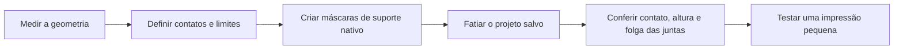

# Dedalo3Dskills

[](LICENSE)

**Mantenha a peça firme. Preserve o movimento das articulações.**

Skills práticas para impressão 3D. A primeira família, **Prender3D**, ajuda um agente de IA a medir a peça, escolher superfícies de contato úteis e aplicar brim nativo e suporte lateral limitado para manter a peça firme na mesa.

[English](README.md) · [Catálogo de skills](#catálogo-de-skills) · [Licença MIT — uso comercial permitido](LICENSE)


## Por que criamos isso

Um cabo alto pode ter pouca área de contato com a mesa. Uma figura articulada pode precisar de apoio no corpo fixo, mas suas juntas devem continuar livres. Suportes aplicados por toda a peça podem dificultar a remoção ou comprometer essas articulações.

O Prender3D começa pela geometria e pelos limites que você define. Ele ajuda a escolher superfícies fixas para contato lateral baixo, proteger juntas e encaixes e ajustar as máscaras ao formato real do objeto. O slicer gera o suporte e o brim nativos permitidos pelo plano. A retenção usa esses recursos removíveis do slicer; a peça não recebe um colar ou uma base sólida modelada.

Esse fluxo nasceu da preparação de impressões reais. Nossos testes físicos com cabos tiveram bons resultados. Essa experiência orienta o trabalho, mas não garante o mesmo resultado para qualquer impressora, material ou geometria.

## Instale as skills

Instale a família com o [skills CLI](https://github.com/vercel-labs/skills), que exige Node.js 22.20 ou mais recente:

```bash
npx skills@latest add MoraesGil/Dedalo3Dskills --skill prender-3d prender-polvo-3d
```

Escolha seu agente quando o instalador perguntar. O CLI instala no projeto atual por padrão; a instalação global é opcional. Mantenha as duas skills para usar a especialização de polvo: ela usa os helpers e as regras comuns do Prender3D.

### Revise o código ou use um checkout

```bash
git clone https://github.com/MoraesGil/Dedalo3Dskills.git
cd Dedalo3Dskills
```

Crie e ative um ambiente virtual Python para sua plataforma. Depois, instale as dependências de geometria:

```bash
python -m pip install -r skills/printing/prender-3d/requirements.txt
```

Peça ao agente para ler o `SKILL.md` correspondente no checkout. Leia esse arquivo antes de executar os helpers. Os arquivos das skills e os helpers Python não instalam um slicer nem fornecem presets de impressora.

## Catálogo de skills

| Skill | Quando usar | Limite principal |
| --- | --- | --- |
| [Prender3D](skills/printing/prender-3d/SKILL.md) | Cabos altos, áreas pequenas de contato e outras peças que precisam de apoio lateral limitado. | Medir a geometria e respeitar as zonas de contato, a altura e as regiões protegidas pedidas para a peça. |
| [PrenderPolvo3D](skills/printing/prender-polvo-3d/SKILL.md) | Polvos articulados que correspondem à geometria de oito braços suportada. | Proteger as juntas e manter o perfil baixo aprovado na base comum fixa. |

O Prender3D é o núcleo reutilizável. O PrenderPolvo3D acrescenta uma distribuição radial medida e um perfil específico para polvo. Novas skills entrarão no catálogo conforme estiverem úteis e prontas para compartilhar.

## Experimente

### Um cabo alto

> Use Prender3D neste cabo. Meça as superfícies fixas e o contato com a mesa. Adicione brim nativo e suporte lateral com altura máxima de 5 mm. Proteja o encaixe e todas as superfícies de ajuste. Mantenha cada cópia como um assembly separado. Meça as folgas antes de organizar as cópias. Preserve a geometria, a pintura e os ajustes de impressão. Mostre o resultado salvo e valide um novo fatiamento.

A altura desse exemplo é uma restrição do pedido, não uma recomendação universal. A altura do apoio, a espessura Z do enforcer e o diâmetro dos ramos são medidas distintas.

### Um polvo articulado

> Use PrenderPolvo3D neste polvo. Primeiro, confirme que a geometria corresponde ao template de oito braços. Use o perfil aprovado de suporte em 0–3 mm na base comum, com contato no corpo fixo e proteção das juntas móveis. Use blockers compactos que acompanhem o formato medido. Mantenha brim fora do corpo, dos tentáculos e da tree. Preserve o assembly e valide o novo G-code.

O perfil de 3 mm se refere à base comum desse template. Ele não significa metade da altura de qualquer cabeça temática e não é um padrão para peças diferentes.

## Como funciona



O agente toma as decisões geométricas e adapta o plano. Os helpers locais ajudam na medição, na criação dos modificadores nativos e nas verificações específicas. Um slicer compatível produz os trajetos reais.

Os apoios devem tocar as superfícies fixas escolhidas e ter continuidade desde a mesa. A validação também deve conferir as regiões protegidas, a folga das máscaras em relação a peças ou torres próximas e a altura do suporte no G-code final. A presença de um modificador no 3MF ou o exit code de sucesso do slicer não bastam por si só.

Consulte o [fluxo de retenção](docs/retention-workflow.md) para o contrato detalhado e a página de [compatibilidade](docs/compatibility.md) para entradas suportadas, dependências e limites atuais.

## Verificações de desenvolvimento

    python scripts/validate_repository.py
    python -m unittest discover -s tests -v

Os testes geram suas próprias geometrias sintéticas. O [workflow opcional do GitHub Actions](docs/ci/README.md) está disponível como exemplo; ele não executa a partir da pasta docs.

## Adicione uma skill útil

Uma contribuição deve resolver um problema concreto de impressão, declarar seu escopo e incluir uma forma reproduzível de conferir o resultado. Use fixtures sintéticas ou arquivos que você tenha permissão para redistribuir. Veja [CONTRIBUTING.md](CONTRIBUTING.md).

## Licença e inspiração

As skills, o código e a documentação originais deste repositório usam a **[licença MIT](LICENSE)**. Uso comercial, modificação e redistribuição são permitidos conforme seus termos. Modelos de entrada, software de impressora e outros arquivos de terceiros mantêm suas próprias licenças; este repositório não concede direitos sobre esses arquivos.

A organização da coleção se inspira no [repositório de skills de Matt Pocock](https://github.com/mattpocock/skills): skills focadas, catálogo claro e um caminho curto da instalação ao uso. O fluxo de impressão e os helpers do Prender3D são trabalho nosso.
