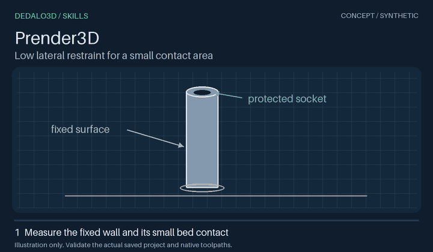
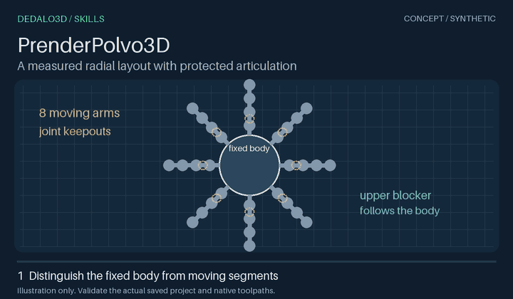
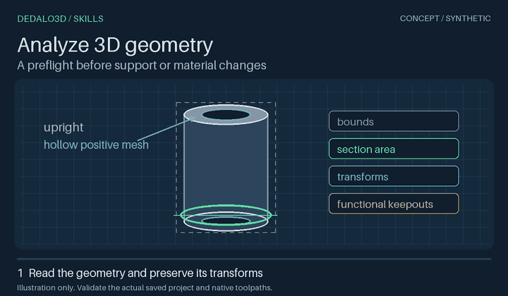
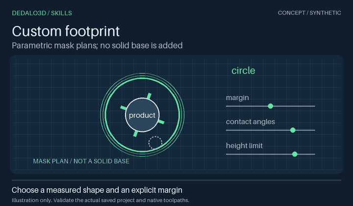
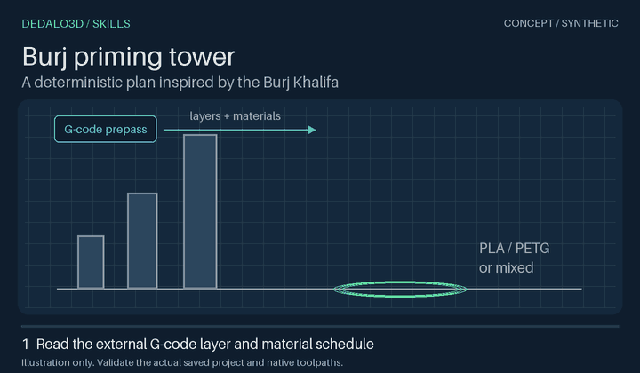

# Skill previews

These are original synthetic concept diagrams. They are not application recordings, native slicer previews, calibrated physics, or physical print results.

Regenerate the assets from the repository root:

    python -m pip install -r tools/requirements-previews.txt
    python tools/render_previews.py

The renderer uses Pillow's bundled font and no customer models. It also writes the collection banner. PNG posters provide a static fallback. Pixel output can change when the renderer dependency changes.

## Prender3D

Low native supports touch measured fixed walls while the socket remains clear.

Apoios nativos baixos tocam a parede fixa medida e preservam o encaixe.

[Static PNG](prender-3d.png)

## PrenderPolvo3D

Eight low side contacts and a small inner contact avoid the articulated joint spaces.

Oito contatos laterais baixos e um apoio interno preservam os espaços das articulações.

[Static PNG](prender-polvo-3d.png)

## Analyze 3D geometry

Inspect positive-mesh sections, transforms and unresolved functional keepouts before modifying the project.

Inspecione seções da malha positiva, transforms e regiões funcionais ainda não resolvidas antes de alterar o projeto.

[Static PNG](analyze-3d-geometry.png)

## Custom footprint

Choose a measured contour, contact layout and height limit for native masks; no solid base is added.

Escolha contorno, contatos e limite de altura para máscaras nativas; nenhuma base sólida é adicionada.

[Static PNG](custom-footprint.png)

## Burj priming tower

The prepass G-code determines layer/material needs. The tower stops at the last real colour change while taller models can continue.

O G-code de pré-fatiamento determina camadas e materiais. A torre termina na última troca real de cor, enquanto modelos mais altos podem continuar.

[Static PNG](torre-burj.png)

