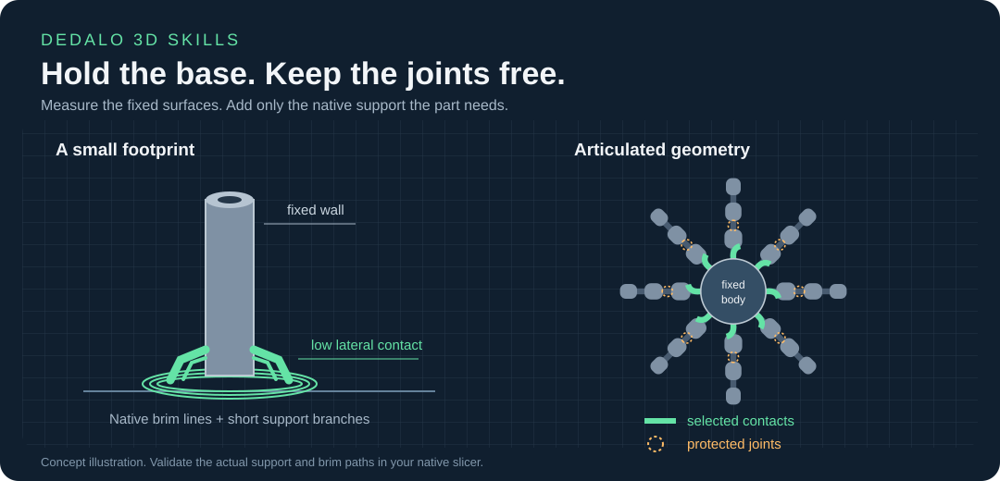
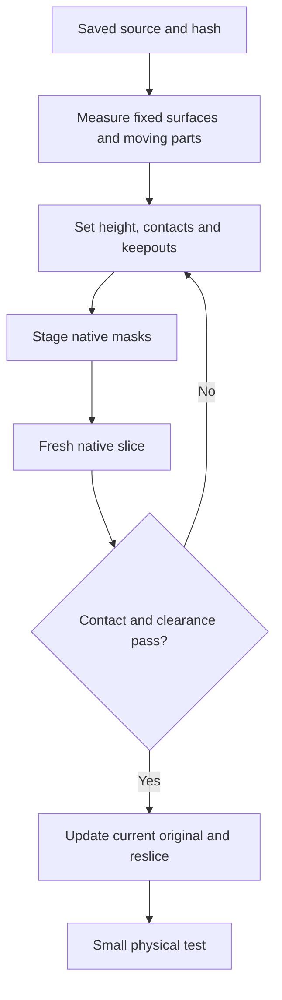

# Prender3D retention workflow

[Back to the catalog](../README.md#skill-catalog)

The goal is low lateral restraint at useful fixed surfaces. The agent measures and plans. Native slicer supports and the permitted brim provide the printed restraint.



## 1. Inspect the source

Start with a saved, complete Orca/Bambu-family 3MF project. Close that document before editing its files. Record its SHA-256 and keep an untouched backup outside the model's production folder.

Identify the printer, bed, material slots, target plate, individual assembly roots, orientations and existing modifiers. Inspect actual meshes and transforms. A filename or a ZIP entry count does not establish geometry or ownership.

Measure the real first-layer footprint. Identify fixed walls that can receive marks, functional holes, sockets, gears, articulated segments and their motion space. Keep an independent assembly for each unit.

The [geometry analysis skill](../skills/analysis/analyze-3d-geometry/SKILL.md) provides a read-only starting report. It does not infer every functional keepout from shape alone.

## 2. Set a bounded plan

Write down:

| Decision | What it controls |
| --- | --- |
| Maximum support height | Highest printed support allowed |
| Enforcer Z thickness | Height of the mask that requests support |
| Branch diameter | Width of the slicer's tree branch |
| Contact surfaces | Fixed surfaces that must actually touch support |
| Keepouts | Joints, fits, sockets and moving geometry that must stay clear |
| Brim policy | Where native brim is permitted, including between copies |
| Physical support material | Existing logical filament slot used by native support |

These dimensions have different meanings. A 3 mm enforcer does not prove that the slicer created a 3 mm support.

There is no universal speed or temperature preset in this package. Preserve the user's calibration and printer integration. Choose spacing from the actual model, support and brim extents, including travel/lift clearance required by that printer.

## 3. Choose masks from the geometry

Use a cylinder for a radial body or a measured outline for another shape. The generic helper can make a conservative rounded convex contour. Concave targets next to other parts need a closer custom mesh and a clearance check.

A narrow box can be appropriate for a local planar contact. A large box around a round object can block a nearby tower or erase useful contact.

Use [custom-footprint](../skills/printing/custom-footprint/SKILL.md) to generate parameterized native mask descriptors from measured contours, selected fixed parts and explicit keepouts. Review the JSON before applying it.

Use only native `support_enforcer` and `support_blocker` parts for retention. Keep the product's normal parts, paint, negative parts and transforms. The core rejects a printable retention collar, base or web.

A blocker excludes support contact candidates. It is not a guaranteed cutter for the entire tree path. Manual support plus restricted enforcers can permit a small upper blocker band. Its actual effect still needs a fresh slice.

## 4. Stage the existing assembly

Install the [Python requirements](../skills/printing/prender-3d/requirements.txt). From this checkout, inspect the command before using it:

    python skills/printing/prender-3d/scripts/apply_retention.py --help

The main CLI accepts a current input hash, a target root, explicit regions, an explicit native support process and a maximum height. It writes a new file in a temporary directory. It does not overwrite the input, slice, or contact a printer.

The regions file is a JSON list. This is a shape-schema illustration for a hypothetical object whose fixed wall and bed are at the shown root-local coordinates:

```json
[
  {
    "role": "fixed_wall_contact",
    "label": "measured fixed wall contact",
    "subtype": "support_enforcer",
    "shape": "cube",
    "values": [[4, 2, 3], [10, 0, 1.5]]
  },
  {
    "role": "upper",
    "label": "measured radial upper blocker",
    "subtype": "support_blocker",
    "shape": "cylinder",
    "values": [12, 3, [0, 0, 4.5], 128]
  }
]
```

Do not copy these coordinates onto another part. The first mask must reach the measured fixed wall; the upper cylinder must cover the actual protected band without reaching neighbours. Add explicit keepouts for moving geometry and fittings.

Example command, with files and IDs selected for your own project:

    python skills/printing/prender-3d/scripts/apply_retention.py \
      part.3mf TEMP_OUTPUT.3mf --expect-sha256 CURRENT_SHA256 \
      --root-id ROOT_ID --regions-json regions.json \
      --process-json support-process.json --height-mm 3

Replace `TEMP_OUTPUT.3mf` with a new absolute path inside the system temporary directory. The process file must select a native manual support mode and explicit existing support/interface filament slots. Read the CLI and skill for the exact accepted settings. It must not replace printer macros or material presets. The guarded CLI enforces retention-only fields; the grid adapter and low-level core API require the caller to validate their broader settings explicitly.

The grid helper is an additional adapter. It creates or updates a separate grid of independently assembled copies; it has plate-layout restrictions and is not the general one-object entrypoint.

## 5. Slice and inspect the result

Use your installed compatible slicer and the staged project. See [slicing](slicing.md). Review all affected plates.

A passing native exit code proves only that the engine produced output. Check the actual deposited lines:

- The feet start on the bed and remain connected between support layers.
- Support touches the intended fixed wall above the first layer, in the intended directions.
- Support stays below the allowed ceiling.
- Extrusion-width envelopes do not enter joints, moving segments, sockets or protected fits.
- Brim appears only where allowed. A connected network comes from native brim/support lines.
- Support, brim, towers, wipes, travel and lift paths fit the actual printer's usable area.
- Material assignment, temperatures, cooling and multi-tool order remain valid.

A custom tower or per-layer colour schedule needs regeneration after a support change. The retention helpers do not handle that work; use the separate [Burj skill](../skills/printing/torre-burj/SKILL.md) and audit its final G-code.

The public package does not include a universal G-code validator. Complete native and geometric checks remain part of the agent's job; do not promote a modifier preview to print validation.

## 6. Publish the accepted file and test

When the staged result is accepted, reread the current original. If it changed, apply the narrow delta to that version and repeat validation. Do not copy an old staging file over newer work.

Save the accepted original 3MF, invalidate its stale G-code and slice that saved original. Deliver the configured 3MF; keep the unedited native G-code in the validation run. Report the path, plate, count, input/output hashes, native exit code, observed checks and remaining physical limits.

Begin with a small physical test. Adhesion, vibration, surface marks, joint movement and removal depend on the actual printer and material.


