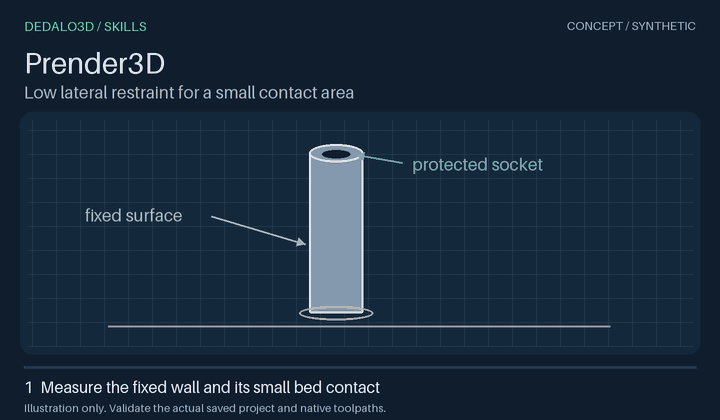

# Prender3D

[Skill catalog](../../../README.md) · [Português brasileiro](README.pt-BR.md) · [Agent instructions and commands](SKILL.md)

Prender3D grew out of printing tall grips. A grip can stand upright on a narrow end and still shift sideways during a print. A brim spreads the first layer across the bed. Short supports can also steady the grip above that layer, provided they reach a fixed wall and stay connected to the bed.

*Concept illustration of lateral support.*

## Try it on a handle

> Use Prender3D on this upright handle. Brace the fixed outer wall within the bottom 3 mm. Use an outer brim and keep the socket open. Return the prepared 3MF.

1. Start with a saved, closed Orca/Bambu-family 3MF project. Identify the handle, measure its first-layer section and mark where support may touch. Choose the support and interface filaments from the slots already in the project.
2. Select the assembly by its root ID. Give the editor the current source hash, the reviewed region list and a separate manual-support process. It stages a temporary 3MF with native masks for the slicer. The product meshes, paint and socket geometry stay part of the original assembly. [Retention workflow](../../../docs/retention-workflow.md)
3. Slice the candidate in the target slicer. Trace each support from its foot on the bed to the intended wall **above the first layer**. Check the actual support height, open socket and brim around each copy. A detached island gives the wall no lateral restraint.

Apply the accepted changes to the current source and slice the saved 3MF again. **Deliver the prepared 3MF.** Inspect the slicer's G-code unchanged in a temporary folder. A physical print measures how well the handle holds, how easily support comes off and where it leaves marks.
