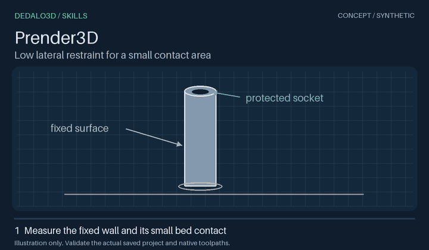

# Prender3D

[Catálogo de skills](../../../README.pt-BR.md) · [English](README.md) · [Instruções e comandos da skill](SKILL.md)

O Prender3D nasceu da experiência de imprimir cabos altos. Um cabo pode ficar em pé sobre uma ponta estreita e ainda se deslocar para o lado durante a impressão. O brim amplia o contato da primeira camada com a mesa. Apoios baixos também podem firmar o cabo acima dessa camada, desde que encostem em uma parede fixa e tenham continuidade até a mesa.

*Ilustração conceitual do apoio lateral.*

## Experimente em um cabo

> Use Prender3D neste cabo em pé. Apoie a parede externa fixa nos primeiros 3 mm de altura. Use brim externo e deixe o encaixe aberto. Entregue o 3MF preparado.

1. Comece com um projeto 3MF completo da família Orca/Bambu, salvo e fechado. Identifique o cabo, meça a seção da primeira camada e marque onde o suporte pode encostar. Escolha os filamentos do suporte e da interface entre os slots existentes.
2. Selecione o conjunto pelo ID da raiz. Informe ao editor o hash atual do original, a lista revisada de regiões e o processo de suporte manual em arquivo separado. Ele prepara um 3MF temporário com as máscaras de suporte do fatiador. O conjunto conserva as malhas da peça, a pintura e a geometria do encaixe. [Fluxo de retenção](../../../docs/retention-workflow.md)
3. Fatie a versão de teste no fatiador de destino. Siga cada apoio desde o pé na mesa até o contato com a parede **acima da primeira camada**. Confira a altura real do suporte, a abertura do encaixe e o brim de cada cópia. Uma ilha separada da parede deixa o cabo sem apoio naquele ponto.

Aplique os ajustes aprovados ao original atual e fatie de novo o 3MF salvo. **Entregue o 3MF preparado.** Inspecione o G-code gerado pelo fatiador em uma pasta temporária, sem editá-lo. A impressão física mostra se o cabo fica firme, quanto esforço exige a remoção do suporte e onde ele deixa marcas.
