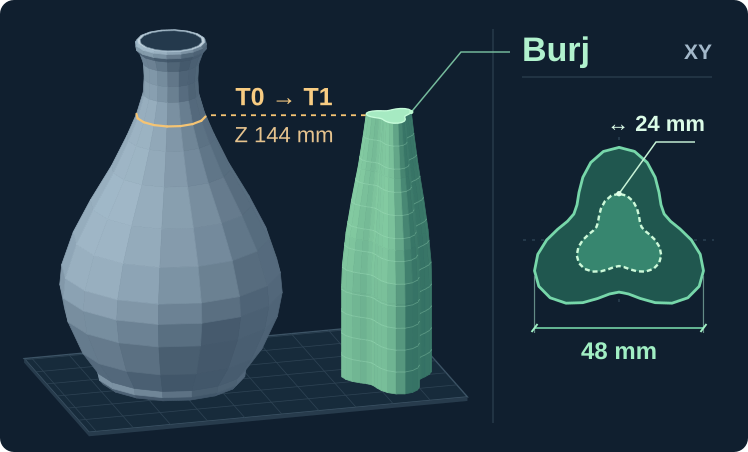

# Burj tower

[Skill catalog](../../../README.md#skill-catalog) · [Português brasileiro](README.pt-BR.md) · [Agent instructions](SKILL.md)

**“No more broken purge towers!”** That was the design brief. On a tall print, losing the tower late wastes much more than the plastic in the tower. We wanted a wider footing, a way to prepare each returning tool before it touches the part, and something we might actually keep. The Burj Khalifa gave us the shape: three rounded wings around a common center, with a narrower profile higher up. If you use a brim, peel it off after printing. The tower can stand on a shelf.

*Read the illustration from bottom to top.* The tower starts at the base width set in the project. When the widest selected part narrows, the tower can narrow too. Here the vase is **184.8 mm tall**. The top view at right shows the **48 mm base** (solid line) and **24 mm top** (dashed line). The top is flat and half the width of the base, excluding brim. There is no decorative spire: the tower ends at the last actual tool change, here at **Z = 144 mm**, even if the model has more layers. This is an illustration of the geometry, not a print photograph.

## One tower, two materials

Our PETG/PLA use case is **PETG for the part, PLA for the support interface in the same job**. The interface is the layer of support that touches the part. These are two physical filaments on separate toolheads. On layers that already use PLA for the interface, the tower can give it a small keyed core inside the PETG shell. The skill does not add a tool change to make a decorative stripe. Virtual mixed-colour recipes are outside this adapter's scope.

After a real tool change, the newly selected head prints the planned perimeter and infill on the Burj **before** depositing on the product or support. Other layers add only the structure needed to keep the tower growing. The native prime tower stays off. A “Flush into this object” checkbox on the U1 does not prove that the new head took this route; the toolpaths show where it went.

## Try it on a project

> Prepare my tall PETG part with PLA support interfaces. Add one Burj, keep my material and temperature settings, and return the editable 3MF. Check that each returning tool visits the Burj first.

Start with a complete, saved Snapmaker Orca project and identify its production plate. A fresh native slice without a tower tells the planner *where the part changes width* and *when the printer changes tools*. The builder puts the tower geometry, material regions, ordering and settings into the project. It does not write extrusion commands.

Slice the **saved, configured 3MF** again with the same engine and plate. Check the tower passages, clearance, commanded material volume and temperatures in the native G-code. If the path is wrong, fix the 3MF and repeat. Any change to support, paint, scale or layout requires a new calculation. **The file you receive is the 3MF.** The prepass and verification G-code are temporary. Our [Snapmaker Orca MCP](https://github.com/MoraesGil/snapmaker-orca-mcp) can run both slices with the GUI closed; [see the example](../../../docs/slicing.md).

## What was tested

The published **native U1 pilot** used a synthetic part with a PETG shell and a PLA interface core. The explicit commands passed the order and extrusion checks for **72 real tool changes**; the tower stopped at **16 mm**, the last change. The larger drawing above illustrates the shape, not that pilot. The strict audit still returned `firmware_unverified` (exit 2): the firmware macro bodies were unavailable. That pilot did not measure tower strength, nozzle cleanliness or adhesion on a physical printer. [Test record and limits](references/native-semantics.md#native-synthetic-verification-scope) · [Options and commands](SKILL.md#procedure)
