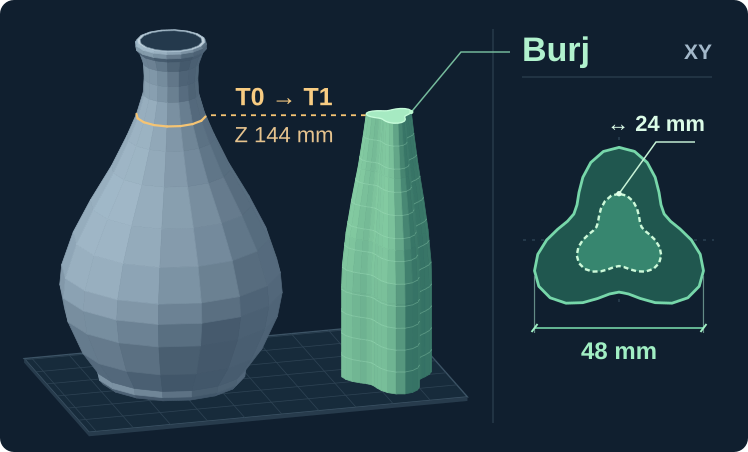

# Torre Burj

[Catálogo de skills](../../../README.pt-BR.md#catálogo-de-skills) · [English](README.md) · [Instruções para o agente](SKILL.md)

**“Torre quebrando? Nunca mais!”** Esse foi o ponto de partida. Quando a torre quebra perto do fim de uma impressão alta, perde-se muito mais que o plástico da torre. Queríamos uma base mais firme, um lugar para preparar o bico antes de ele voltar à peça e uma torre que desse vontade de guardar. A Burj Khalifa inspirou o formato: três alas arredondadas ao redor de um núcleo, com um perfil mais estreito no alto. Se usar brim, retire-o após a impressão. A torre pode ir para a estante.

*Leia a ilustração de baixo para cima.* A torre começa com a largura de base definida no projeto. Quando a mais larga das peças selecionadas afina, a torre também pode afinar. No exemplo, o vaso mede **184,8 mm de altura**. A vista superior à direita mostra a base de **48 mm** (linha contínua) e o topo de **24 mm** (linha tracejada). O topo é plano e tem metade da largura da base, sem contar o brim. Não há antena decorativa: a torre termina na última troca real de cabeçote, aqui em **Z = 144 mm**, mesmo quando a peça ainda tem camadas pela frente. A imagem ilustra a geometria; não é uma foto de impressão.

## Uma torre, dois materiais

Nosso caso de uso com filamentos mistos foi **PETG na peça e PLA na interface do suporte, na mesma impressão**. A interface é a camada do suporte que encosta na peça. São dois filamentos físicos em cabeçotes separados. Nas camadas em que o PLA já imprime a interface, ele pode formar um pequeno núcleo com encaixe dentro da parede de PETG da torre. A skill não acrescenta uma troca só para formar uma faixa decorativa. O adaptador não usa receitas de cores virtuais.

A cada troca real, o novo cabeçote imprime o contorno e o preenchimento previstos na Burj **antes** de depositar material na peça ou no suporte. Nas camadas sem troca, a torre recebe apenas a estrutura necessária para continuar crescendo. A prime tower nativa fica desligada. Na U1, marcar “Flush into this object” não comprova que o cabeçote passou pela torre; isso se confere nas trajetórias.

## Como pedir

> Prepare minha peça alta de PETG com PLA nas interfaces dos suportes. Inclua uma Burj, preserve meus materiais e temperaturas e me devolva o 3MF editável. Confira se, a cada troca, o cabeçote passa primeiro na torre.

Comece com o projeto completo salvo no Snapmaker Orca e indique a mesa de produção. Um pré-fatiamento nativo sem torre mostra *onde a peça muda de largura* e *quando há troca de ferramenta*. A skill grava no projeto a geometria da torre, as regiões de cada material, a ordem e as configurações. Ela não escreve comandos de extrusão.

Fatie novamente o **3MF salvo e configurado**, com o mesmo motor e a mesma mesa. Confira as passagens na torre, as folgas, o volume de material comandado e as temperaturas no G-code nativo. Se a trajetória estiver errada, corrija o 3MF e repita. Mudar suporte, pintura, escala ou disposição exige refazer o cálculo. **O arquivo que você recebe é o 3MF.** Os G-codes de pré-fatiamento e conferência são temporários. Nosso [Snapmaker Orca MCP](https://github.com/MoraesGil/snapmaker-orca-mcp) faz os dois fatiamentos com a interface fechada; [veja o exemplo](../../../docs/slicing.md).

## O que foi testado

O **piloto público no motor nativo da U1** usou uma peça sintética, com PETG na parede da torre e PLA no núcleo de interface. Os comandos explícitos passaram nas verificações de ordem e extrusão em **72 trocas reais**. A torre parou em **16 mm**, na última troca. A ilustração acima mostra o formato em escala maior, não a peça do piloto. A auditoria completa retornou `firmware_unverified` (código de saída 2): o conteúdo das macros do firmware não estava disponível. Esse piloto não mediu resistência da torre, limpeza do bico nem adesão em uma impressora física. [Registro do teste e limites](references/native-semantics.md#native-synthetic-verification-scope) · [Opções e comandos](SKILL.md#procedure)
